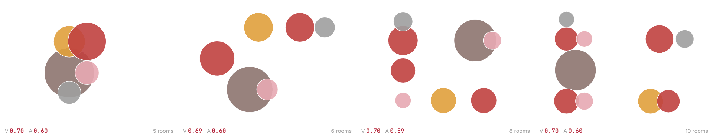
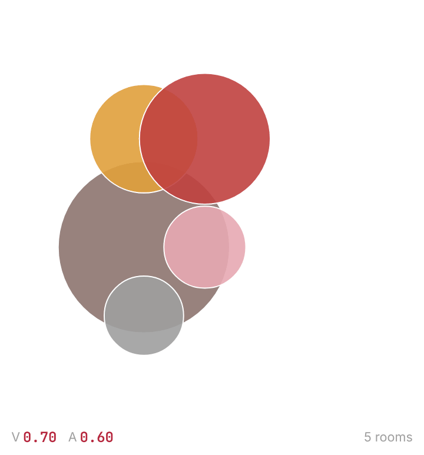
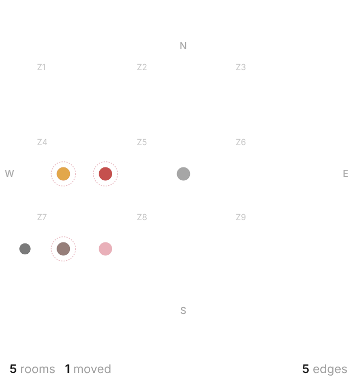
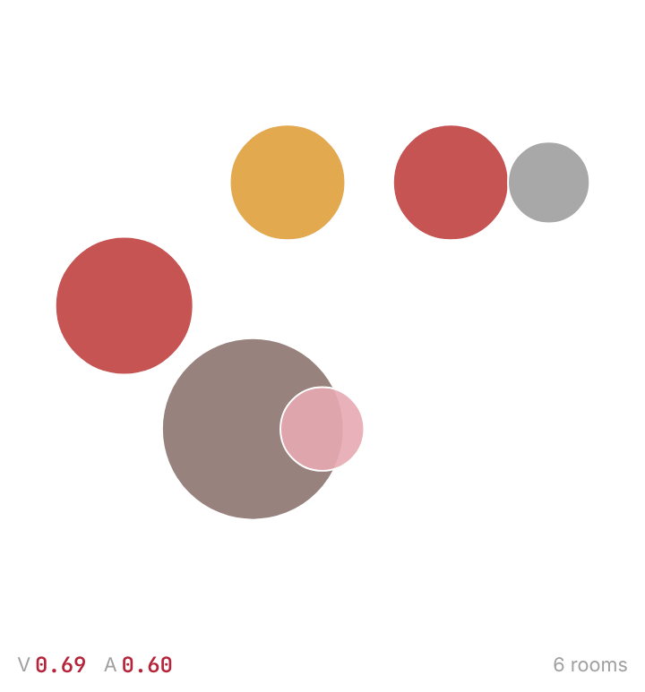
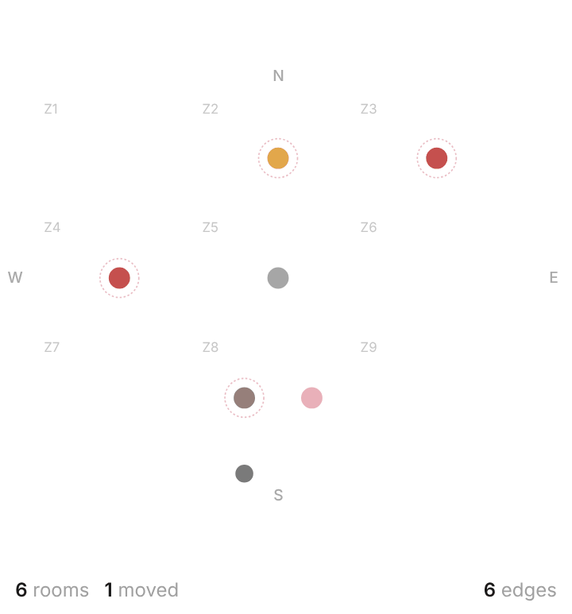
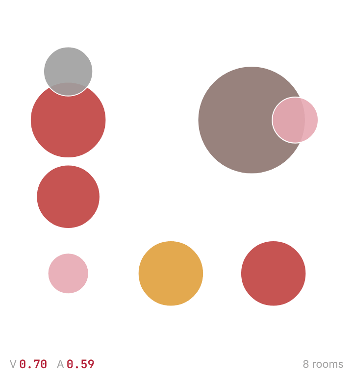
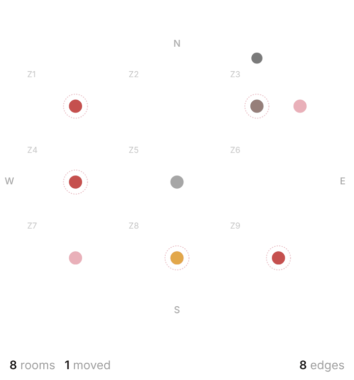
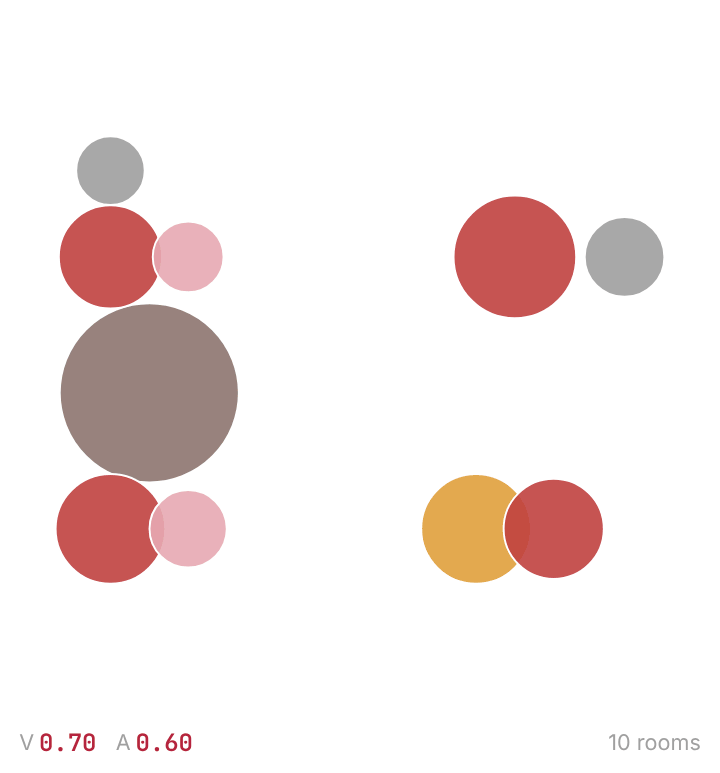
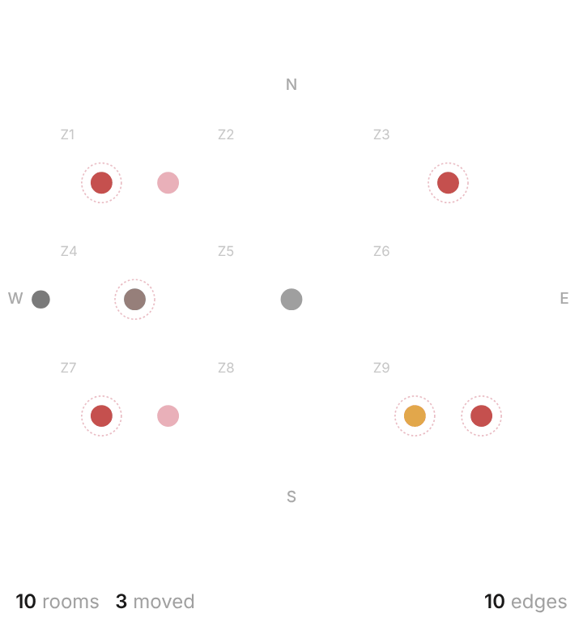

# Target2Plan

Target2Plan goes from a room program and two plan-level targets, QVCI (Quality View Coverage Index) and AQI (Acoustic Quality Index), to zone assignments, connectivity graphs and schematic floor plans. Two trained models are at its core, a cGAT-AR zone model and a connectivity model. A third, the area distribution model, is optional: the room program can be drawn by hand instead.

Target2Plan was developed as Shafiul Islam's thesis in the Master of Science in Architecture / Design Technology program at the University of Washington (Department of Architecture, College of Built Environments), supervised by Tomás Méndez Echenagucia.


*Four apartments generated for the targets QVCI 0.70 and AQI 0.60, drawn at one scale: from the rooms at their connectivity positions to walls, doors, windows and furniture. Q and A are the QVCI and AQI each plan reaches.*

The repository has two front ends that share the same checkpoints in `assets/checkpoints/`:

| | where | how to run |
|---|---|---|
| Desktop app (PySide6) | `main.py`, `app/`, `models/`, `stages/` | `python main.py` (see `JOURNAL_VERSION_NOTES.md`) |
| Web app | `docs/` | **https://shafiarch.github.io/Target2Plan/** |

## Gallery

Four conventional apartment programs, generated with the web app's engine for the default site (north: vegetation view, 55 dB; south: urban view, 70 dB; east: no view, 65 dB; west: sky view, 60 dB), the default targets (QVCI 0.70, AQI 0.60) and the default generation parameters, with the room program drawn at common room sizes. Left, the schematic synthesis of a plan: the rooms start at their connectivity positions, pack together and get walls, doors, windows and furniture. Right, the connectivity graph of the same plan: the predicted edges appear one by one, then the secondary rooms move next to the room they connect to. Q and A under each plan are the QVCI and AQI it reaches.

<table>
  <tr>
    <td></td>
    <td></td>
  </tr>
  <tr><td colspan="2" align="center"><b>1 bedroom</b>: living room, kitchen, bathroom, balcony; 51 m²; QVCI 0.70, AQI 0.60</td></tr>
  <tr>
    <td></td>
    <td></td>
  </tr>
  <tr><td colspan="2" align="center"><b>2 bedrooms</b>: living room, kitchen, bathroom, balcony; 67 m²; QVCI 0.69, AQI 0.60</td></tr>
  <tr>
    <td></td>
    <td></td>
  </tr>
  <tr><td colspan="2" align="center"><b>3 bedrooms</b>: living room, kitchen, 2 bathrooms, balcony; 86 m²; QVCI 0.70, AQI 0.59</td></tr>
  <tr>
    <td></td>
    <td></td>
  </tr>
  <tr><td colspan="2" align="center"><b>4 bedrooms</b>: living room, kitchen, 2 bathrooms, 2 balconies; 109 m²; QVCI 0.70, AQI 0.60</td></tr>
</table>

Not every generated plan is usable as drawn: the packing can leave two rooms that the graph connects without a shared wall, so the door between them is missing. The plans shown pass a practicality check: every connection in the graph is a door or an opening on a shared wall (at least 1.2 m, and 1.8 m for the open kitchen); every room is reachable from the entrance; the kitchen, every bedroom and a bathroom open off the living room; the living room and the bedrooms have windows; and no edge of the graph runs over a room it does not join. The gallery shows passing plans close to the targets, taken from several samples of the zone and connectivity models. The GIFs are made with `tools/gallery/` (see `tools/README.md`).

## Web app

The web app runs entirely in the browser. The checkpoints are exported to static files and evaluated in JavaScript inside a Web Worker, so there is no server, no install and nothing leaves the machine. GitHub Pages serves it straight from the `docs/` folder of `main`.

It follows the desktop workflow, one card per stage:

1. **Inputs**: targets with the reachable range, site conditions per facade, planned WWR, zone capacity, generation parameters.
2. **Area Distribution**: draw the room program on a grid (zoom with the wheel or the zoom buttons, pan with middle-drag or Space + drag), or, optionally, sample area variations from the area distribution model (Farthest point or KMeans selection).
3. **Zone Assignments**: zone model decodes (one greedy plus sampled), sorted by distance to the targets, with the design explorer (parallel coordinates with brushing) and a detail view per plan.
4. **Connectivity**: access graphs from the connectivity model, with secondary rooms relocated next to the room they connect to; animated.
5. **Schematic Design**: packed plans with walls, doors, windows and furniture (line drawing or fill, at several strengths), the replayable synthesis, a details card for any room you click, and the Pareto front.

On a phone the stages become one screen each, with tabs under the header to move between them; the drawing canvas zooms with a pinch.

Exports: zone cards and plans as PNG (zipped when several), contact sheets, Pareto image and CSV, synthesis animations as GIF and MP4 (MP4 in browsers that can encode H.264 through WebCodecs, such as current Chrome and Edge; elsewhere the GIF alone), and the whole session as a `.json` file that can be loaded again. Three themes: off-white, white and dark.

### Run it locally

ES modules do not load from `file://`, so serve the folder:

```
cd docs
python3 -m http.server 8000
```

then open http://localhost:8000.

### Layout

```
docs/
  index.html, css/app.css
  js/app.js          header, stage strip, sessions, theme
  js/store.js        session state and change events
  js/runtime.js      starts the worker (falls back to the main thread)
  js/worker.js       runs the three models off the main thread
  js/engine/         ports of models/*.py: nn.js (the networks), area.js,
                     zones.js, scoring.js, relocation.js, connectivity.js,
                     schematic.js, rng.js and pymath.js (Python and numpy
                     random, rounding and summation)
  js/ui/             the five stage cards, canvases, detail views, exporters
  js/vendor/         gifenc 1.0.3 and mp4-muxer 5.2.2 (MIT, licences alongside)
  models/            exported weights: <model>.bin (float32) + <model>.json
tools/
  export_weights.py  checkpoints to docs/models (no PyTorch needed)
  ptload.py          minimal reader for PyTorch .pt files
  parity/            checks the web engine against the desktop code
  gallery/           renders the README gallery into media/gallery/
```

### After retraining a model

Replace the checkpoint in `assets/checkpoints/` and export the weights again:

```
python3 tools/export_weights.py assets/checkpoints docs/models
```

Commit `docs/models/` and Pages picks it up. See `tools/README.md` for the parity checks.

### How Stage 2 uses the targets

The zone assignments are predicted by the trained zone model, conditioned on the requested QVCI and AQI: the targets enter the decoder at every step, together with the site context and the zones already used. As in the desktop app, the model is decoded 81 times: once greedily (the most likely zone at every step, no randomness) and 80 times by drawing from the model's own predicted probabilities at temperature 0.8. The arrangements are scored with the journal equations and the 12 closest to the targets are shown.

### How close is it to the desktop app

The web engine is a step-for-step port. On the same inputs the networks agree with PyTorch to about 1e-5 on the logits, so the predicted probabilities and the greedy decode are the same as the desktop's, and Stages 2 to 4 (scoring, relocation, packing, walls, openings, furniture, Pareto front) reproduce the desktop output exactly. The 80 sampled decodes take their random draws from a JavaScript generator instead of PyTorch's. The desktop app draws a fresh set on every run as well, so in both apps the sampled cards change from run to run while coming from the same model probabilities.

## Thesis

* Author: Shafiul Islam
* Program: Master of Science in Architecture / Design Technology, Department of Architecture, University of Washington
* Thesis supervisor: Tomás Méndez Echenagucia, Associate Professor, Department of Architecture
* Thesis committee member: Mohammad Tabatabaei Manesh, PhD student, Design Technology, UW

## Credits

The furniture placement in the schematic synthesis is a port of the furniture placement logic in **RGeoLib**, the research geometry library of the Hypergraph project by **Ramon Elias Weber** ([github.com/ramonweber/hypergraph](https://github.com/ramonweber/hypergraph), MIT License). The desktop app (`models/schematic_layout.py`) carries the Python port and the web app (`docs/js/engine/schematic.js`) the JavaScript one. Please also cite:

> Weber, R. E., Mueller, C. & Reinhart, C. A hypergraph model shows the carbon reduction potential of effective space use in housing. *Nature Communications* 15, 8327 (2024). https://doi.org/10.1038/s41467-024-52506-z

The web app's GIF export uses gifenc by Matt DesLauriers and its MP4 export mp4-muxer by Vanilagy (both MIT). See [THIRD_PARTY_NOTICES.md](THIRD_PARTY_NOTICES.md) for the full notices.

## License

© 2026 Shafiul Islam. The code, the trained model weights, the documentation and the website are licensed under [CC BY-NC 4.0](https://creativecommons.org/licenses/by-nc/4.0/) (see [LICENSE](LICENSE)):

* anyone may copy, share and adapt this work for non-commercial purposes;
* full credit is required: name the author, Target2Plan and its origin as a University of Washington MS Design Technology thesis, link to this repository and the license, and say what was changed;
* commercial use, including selling this work or products and services built on it, is not permitted without separate written permission from the author.

Suggested credit: *Target2Plan by Shafiul Islam (MS in Architecture / Design Technology thesis, University of Washington, supervised by Tomás Méndez Echenagucia), https://github.com/ShafiArch/Target2Plan, licensed under CC BY-NC 4.0.*

Third-party components keep their own licenses ([THIRD_PARTY_NOTICES.md](THIRD_PARTY_NOTICES.md)).
