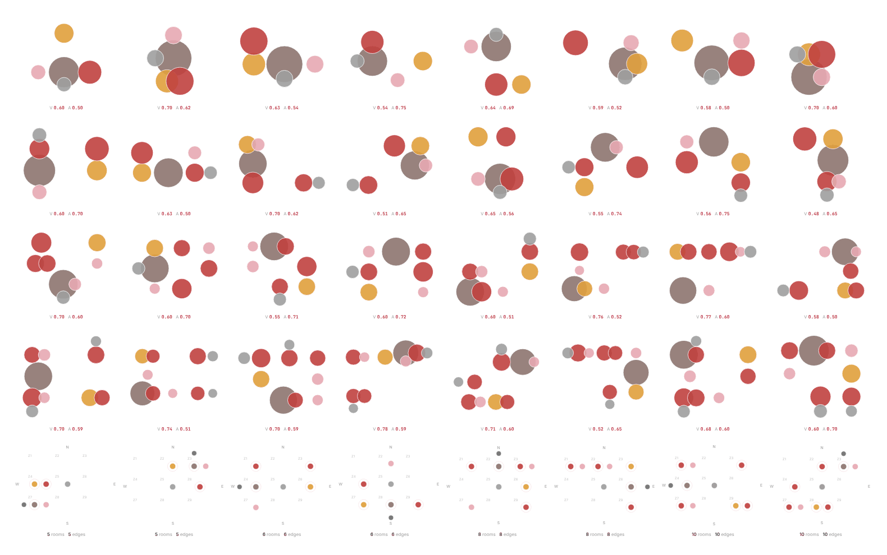

# Target2Plan

Target2Plan goes from a room program and two plan-level targets, QVCI (Quality View Coverage Index) and AQI (Acoustic Quality Index), to zone assignments, connectivity graphs and schematic floor plans. Two trained models are at its core, a cGAT-AR zone model and a connectivity model. A third, the area distribution model, is optional: the room program can be drawn by hand instead.

Target2Plan was developed as Shafiul Islam's thesis in the Master of Science in Architecture / Design Technology program at the University of Washington (Department of Architecture, College of Built Environments), supervised by Tomás Méndez Echenagucia.


*Four apartments generated for the targets QVCI 0.70 and AQI 0.60, drawn at one scale: from the rooms at their connectivity positions to walls, doors, windows and furniture. V and A are the QVCI and AQI each plan reaches.*

## Use it

* **Online:** **https://shafiarch.github.io/Target2Plan/**, nothing to install. Version 1.0, as first released, stays online at https://shafiarch.github.io/Target2Plan/v1/.
* **As an app from the browser:** open the site in Chrome or Edge and click **Install app** in the header (or the install icon in the address bar); in Safari on a Mac, choose File, Add to Dock. It then opens in its own window and works offline.
* **Desktop app for Windows, macOS and Linux:** download the installer from the [latest release](https://github.com/ShafiArch/Target2Plan/releases/latest): the `.exe` (or `.msi`) for Windows, the `.dmg` for macOS (Apple silicon and Intel), the `.AppImage` or `.deb` for Linux.

The installers are not code-signed yet, so the system asks once before the first start. On Windows, if SmartScreen says "Windows protected your PC", click More info, then Run anyway. On macOS, try to open the app, then go to System Settings, Privacy & Security, click Open Anyway and enter your password.

The web app and the desktop app are the same program. The original prototype is the Python desktop app the thesis started from; all three use the trained checkpoints in `assets/checkpoints/`.

| | where | how to run |
|---|---|---|
| Web app | `docs/` | **https://shafiarch.github.io/Target2Plan/** |
| Desktop app (Tauri) | `desktop/`, built from `docs/` | installers on the [Releases](https://github.com/ShafiArch/Target2Plan/releases) page |
| Original prototype (Python, PySide6) | `main.py`, `app/`, `models/`, `stages/` | `python main.py` (see `JOURNAL_VERSION_NOTES.md`) |

## Gallery

Four conventional apartment programs, generated with the web app's engine for the default site (north: vegetation view, 55 dB; south: urban view, 70 dB; east: no view, 65 dB; west: sky view, 60 dB), the default targets (QVCI 0.70, AQI 0.60) and the default generation parameters, with the room program drawn at common room sizes. Left, the schematic synthesis of a plan: the rooms start at their connectivity positions, pack together and get walls, doors, windows and furniture. Right, the connectivity graph of the same plan: the predicted edges appear one by one, then the secondary rooms move next to the room they connect to. V and A under each plan are the QVCI and AQI it reaches.

<table>
  <tr>
    <td></td>
    <td></td>
  </tr>
  <tr><td colspan="2" align="center"><b>1 bedroom</b>: living room, kitchen, bathroom, balcony; 51 m²; QVCI 0.70, AQI 0.60</td></tr>
  <tr>
    <td></td>
    <td></td>
  </tr>
  <tr><td colspan="2" align="center"><b>2 bedrooms</b>: living room, kitchen, bathroom, balcony; 67 m²; QVCI 0.69, AQI 0.60</td></tr>
  <tr>
    <td></td>
    <td></td>
  </tr>
  <tr><td colspan="2" align="center"><b>3 bedrooms</b>: living room, kitchen, 2 bathrooms, balcony; 86 m²; QVCI 0.70, AQI 0.59</td></tr>
  <tr>
    <td></td>
    <td></td>
  </tr>
  <tr><td colspan="2" align="center"><b>4 bedrooms</b>: living room, kitchen, 2 bathrooms, 2 balconies; 109 m²; QVCI 0.70, AQI 0.60</td></tr>
</table>



## Web app

The web app runs entirely in the browser. The checkpoints are exported to static files and evaluated in JavaScript inside a Web Worker, so there is no server, no install and nothing leaves the machine. GitHub Pages serves it straight from the `docs/` folder of `main`. Installed from the browser, a service worker keeps the app, its fonts and the models, so it also starts and runs offline.

It follows the workflow of the original prototype, one card per stage:

1. **Inputs**: targets with the reachable range, site conditions per facade, planned WWR, zone capacity, generation parameters.
2. **Area Distribution**: draw the room program on a grid (zoom with the wheel or the zoom buttons, pan with middle-drag or Space + drag, and draw full screen with the corner button; Esc leaves it), or, optionally, sample area variations from the area distribution model (Farthest point or KMeans selection). The canvas edits like a CAD tool: select with a click, Ctrl or Shift + click, or a box; copy, cut and paste (Ctrl+C, Ctrl+X, Ctrl+V), duplicate (Ctrl+D), undo and redo (Ctrl+Z, Ctrl+Shift+Z or Ctrl+Y), nudge with the arrow keys (Shift for 1 m) and turn a room with R. Moved and resized rooms snap to the edges and centres of the other rooms, with guide lines showing what lined up; hold Alt to place freely, or switch Snap off. On a Mac, ⌘ stands for Ctrl.
3. **Zone Assignments**: zone model decodes (one greedy plus sampled), sorted by distance to the targets, with the design explorer (parallel coordinates with brushing) and a detail view per plan.
4. **Connectivity**: access graphs from the connectivity model, with secondary rooms relocated next to the room they connect to; animated.
5. **Schematic Design**: packed plans with walls, doors, windows and furniture (line drawing or fill, at several strengths), the replayable synthesis, a details card for any room you click, and the Pareto front. The connectivity edges and the Pareto front start hidden; their buttons show them. **Edit selected** opens the selected plans in the plan editor (see below).

### The plan editor

**Edit selected**, next to **Export selected**, opens the selected plans one at a time on a canvas like the drawing canvas of Stage 1. Rooms move and resize with the same snapping, so walls line up, and with the same undo, redo, nudging and turning; a room's width and depth can also be typed in. Walls, doors, windows, furniture and the scores follow every change at once. The side panel shows the selected room (zone, exterior walls, view and acoustic scores) and checks the plan: overlapping rooms, connected rooms that no longer share a wall long enough for a door, a missing entrance.

An edited plan is not a new generation; it stays the same plan, marked **EDITED** on its card:

* **Replace** puts the edit into the plan and moves on to the next selected plan;
* **Save** puts it in and saves the session file, edits included (loading the session brings them back);
* **Export** writes the plan as drawn: JPG on white, PNG with a transparent background, DXF for CAD (rooms, walls, glazing, doors, furniture and labels on their own layers, in metres; it opens in AutoCAD, which saves it as DWG, Revit and Rhino) or a vector PDF to scale on A3 with a scale bar;
* **Discard** drops the changes; **Reset to generated** brings back the plan as it was generated.

Synthesising the plans again (**Regenerate**, or **Proceed to Schematic** after a change in an earlier stage) asks first when plans are edited.

How an edited plan is scored: in Stages 2 to 4 each room's zone comes from the zone plan. In the editor it comes from the drawing: a room takes the zone of the façades it really touches (an exterior wall of at least 1.2 m on a side; the longer of north and south, the longer of east and west; none is the interior zone). The journal equations then give each room's view and acoustic scores and the plan's QVCI and AQI, weighted by the drawn room areas. The editor shows these values (V and A, as drawn) next to the zone plan's own.

On a phone the stages become one screen each, with tabs under the header to move between them; the drawing canvas zooms with a pinch.

Exports: zone cards and plans as PNG (zipped when several), contact sheets, Pareto image and CSV, synthesis animations as GIF and MP4 (MP4 in browsers that can encode H.264 through WebCodecs, such as current Chrome and Edge; elsewhere the GIF alone), a plan from the plan editor as JPG, PNG, DXF or PDF, and the whole session as a `.json` file that can be loaded again. Three themes: white, off-white and dark. The app always opens in white, whatever the computer's light or dark setting.

### Run it locally

ES modules do not load from `file://`, so serve the folder:

```
cd docs
python3 -m http.server 8000
```

then open http://localhost:8000.

### Layout

```
docs/
  index.html, css/app.css, css/fonts.css
  manifest.webmanifest, sw.js   installing from the browser, offline use
  fonts/             Inter and JetBrains Mono (SIL Open Font License)
  icons/             the logo (logo.svg) and the app icons
  js/app.js          header, stage strip, sessions, theme
  js/store.js        session state and change events
  js/runtime.js      starts the worker (falls back to the main thread)
  js/worker.js       runs the three models off the main thread
  js/engine/         ports of models/*.py: nn.js (the networks), area.js,
                     zones.js, scoring.js, relocation.js, connectivity.js,
                     schematic.js, rng.js and pymath.js (Python and numpy
                     random, rounding and summation); layout.js rebuilds and
                     scores a plan edited by hand
  js/ui/             the five stage cards, canvases, detail views, exporters;
                     planEditor.js, planEdit.js and planExport.js are the
                     plan editor, its edits and its JPG, PNG, PDF, DXF output
  js/vendor/         gifenc 1.0.3 and mp4-muxer 5.2.2 (MIT, licences alongside)
  models/            exported weights: <model>.bin (float32) + <model>.json
  v1/                version 1.0 as released, kept online (its own worker and cache)
tools/
  export_weights.py  checkpoints to docs/models (no PyTorch needed)
  ptload.py          minimal reader for PyTorch .pt files
  parity/            checks the web engine against the prototype's Python code
desktop/
  package.json       the Tauri command line tool
  stage-web.mjs      copies docs/ (without v1/) into the app before a build
  src-tauri/         the desktop app: tauri.conf.json, src/main.rs,
                     capabilities/, icons/ (from desktop/icon.svg)
.github/workflows/desktop.yml   builds the installers
.github/release-notes.md        the text of each desktop release
```

### After retraining a model

Replace the checkpoint in `assets/checkpoints/` and export the weights again:

```
python3 tools/export_weights.py assets/checkpoints docs/models
```

Commit `docs/models/` and Pages picks it up. See `tools/README.md` for the parity checks.

### How Stage 2 uses the targets

The zone assignments are predicted by the trained zone model, conditioned on the requested QVCI and AQI: the targets enter the decoder at every step, together with the site context and the zones already used. As in the original prototype, the model is decoded 81 times: once greedily (the most likely zone at every step, no randomness) and 80 times by drawing from the model's own predicted probabilities at temperature 0.8. The arrangements are scored with the journal equations and the 12 closest to the targets are shown.

### How close is it to the original prototype

The web engine is a step-for-step port. On the same inputs the networks agree with PyTorch to about 1e-5 on the logits, so the predicted probabilities and the greedy decode are the same as the prototype's, and Stages 2 to 4 (scoring, relocation, packing, walls, openings, furniture, Pareto front) reproduce the prototype's output exactly. The 80 sampled decodes take their random draws from a JavaScript generator instead of PyTorch's. The prototype draws a fresh set on every run as well, so in both the sampled cards change from run to run while coming from the same model probabilities.

## Desktop app

The desktop app is the web app in a native window, built with [Tauri](https://tauri.app): the same files from `docs/` (copied in by `desktop/stage-web.mjs` at each build, leaving out the archived `v1/`), run by the computer's own web engine (Edge WebView2 on Windows, WebKit on macOS and Linux). It differs only where a desktop program should: exports and sessions are saved through the system's Save dialog, confirmations use system dialogs and links open in the default browser. Everything runs offline.

Installers are built on GitHub by `.github/workflows/desktop.yml`. To publish a version:

1. On the **Actions** tab, choose **Desktop app** and click **Run workflow**.
2. Tick **Make a draft release** and click **Run workflow**.
3. A few minutes later the **Releases** page holds a draft named after the version in `desktop/src-tauri/tauri.conf.json` (v1.0.0, ...), with the Windows, macOS and Linux installers and the notes from `.github/release-notes.md`. Check it and click **Publish release**.

For the next version, raise `version` in `desktop/src-tauri/tauri.conf.json` and `desktop/src-tauri/Cargo.toml` first; a version that is already published is refused. A run without the tick, and every push to the `next` branch (where the next version is prepared), only builds the installers and keeps them with the run, to download and try.

To build on your own computer, install Rust and the [Tauri prerequisites](https://tauri.app/start/prerequisites/) for your system, then:

```
cd desktop
npm ci
npm run build
```

## Thesis

* Author: Shafiul Islam
* Program: Master of Science in Architecture / Design Technology, Department of Architecture, University of Washington
* Thesis supervisor: Tomás Méndez Echenagucia, Associate Professor, Department of Architecture
* Thesis committee member: Mohammad Tabatabaei Manesh, PhD student, Design Technology, UW

## Credits

The furniture placement in the schematic synthesis is a port of the furniture placement logic in **RGeoLib**, the research geometry library of the Hypergraph project by **Ramon Elias Weber** ([github.com/ramonweber/hypergraph](https://github.com/ramonweber/hypergraph), MIT License). The original prototype (`models/schematic_layout.py`) carries the Python port, and the web and desktop apps (`docs/js/engine/schematic.js`) the JavaScript one. Please also cite:

> Weber, R. E., Mueller, C. & Reinhart, C. A hypergraph model shows the carbon reduction potential of effective space use in housing. *Nature Communications* 15, 8327 (2024). https://doi.org/10.1038/s41467-024-52506-z

The GIF export uses gifenc by Matt DesLauriers and the MP4 export mp4-muxer by Vanilagy (both MIT); the fonts are Inter and JetBrains Mono (SIL Open Font License) and the desktop app is built with Tauri (MIT or Apache 2.0). See [THIRD_PARTY_NOTICES.md](THIRD_PARTY_NOTICES.md) for the full notices.

## License

© 2026 Shafiul Islam. The code, the trained model weights, the documentation and the website are licensed under [CC BY-NC 4.0](https://creativecommons.org/licenses/by-nc/4.0/) (see [LICENSE](LICENSE)):

* anyone may copy, share and adapt this work for non-commercial purposes;
* full credit is required: name the author, Target2Plan and its origin as a University of Washington MS Design Technology thesis, link to this repository and the license, and say what was changed;
* commercial use, including selling this work or products and services built on it, is not permitted without separate written permission from the author.

Suggested credit: *Target2Plan by Shafiul Islam (MS in Architecture / Design Technology thesis, University of Washington, supervised by Tomás Méndez Echenagucia), https://github.com/ShafiArch/Target2Plan, licensed under CC BY-NC 4.0.*

Third-party components keep their own licenses ([THIRD_PARTY_NOTICES.md](THIRD_PARTY_NOTICES.md)).
